# Aquenda · Inteligência Artificial & Machine Learning

Global Solution 2026.2 · FIAP · CitizenTech

O Aquenda é um app para a comunidade LGBTQIAPN+ de São Paulo, com casas de acolhimento, salas de conversa moderadas e um mapa de serviços. Nesta entrega, o problema vira duas perguntas de Machine Learning, respondidas com dados públicos reais:

| | Pergunta | Modelo |
|---|---|---|
| **Parte 1 · Quem precisa de retorno** | Quando uma pessoa LGBTQIAPN+ é atendida por violência na cidade de São Paulo, dá para saber, pelo que a ficha registra, se essa violência **já aconteceu outras vezes**? | XGBoost (classificação) |
| **Parte 2 · Onde falta cuidado** | Quais municípios do estado formam **desertos de cuidado**, com violência contra pessoas LGBTQIAPN+, cuidado longe e pouca renda para chegar até ele? | KMeans + PCA (agrupamento) |

| Integrante | RM |
|---|---|
| Giovanne Charelli Zaniboni Silva | 556223 |
| Gustavo Oliveira de Moura | 555827 |
| Lynn Bueno Rosa | 551102 |

O relatório completo está em [`RELATORIO_ML.md`](RELATORIO_ML.md).

## Resumo

### Parte 1 · Violência de repetição (XGBoost)

- **Dados:** 9.856 notificações de violência interpessoal do SINAN (DATASUS), cidade de São Paulo, 2015 a 2024, com pessoa homossexual, bissexual, travesti ou trans. Em 45,6% delas, a violência já tinha acontecido antes.
- **Treino:** 36 combinações de `max_depth`, `learning_rate` e `n_estimators`, com validação cruzada de 5 partes só no treino (2015–2023). O teste é 2024, usado uma vez no fim.
- **Resultado:** ROC-AUC 0,830 no treino, 0,804 na validação cruzada e **0,798 no teste**, contra 0,789 de uma regressão logística. O modelo encontra 83% dos casos de repetição de 2024.
- **Para o cidadão:** com autor da família, 72% dos casos já tinham acontecido antes. Com parceiro(a) ou ex, 66%. Com desconhecido na rua, 20%. A violência que se repete está em casa.

### Parte 2 · Desertos de cuidado (KMeans + PCA)

- **Dados:** os 645 municípios do estado, com notificações de violência (SINAN 2022–2024), distância até CAPS, serviço trans habilitado e atenção à violência sexual (CNES dez/2024), e renda per capita (IBGE, Censo 2022). Só 2 municípios do estado têm serviço habilitado pelo SUS no processo transexualizador.
- **Treino:** 36 combinações de `n_clusters`, componentes do PCA e `init`, com validação cruzada de 5 partes só no treino (516 municípios). O teste são 129 municípios separados ao acaso.
- **Resultado:** 6 grupos, silhueta 0,274 no treino e **0,225 no teste**, estabilidade 0,89 entre partes do treino.
- **Para o cidadão:** o **deserto de cuidado** tem 177 municípios e 1,7 milhão de pessoas, com 573 notificações de violência contra pessoas LGBTQIAPN+ em 2022–2024. Nenhum desses municípios tem CAPS, e o serviço trans habilitado mais próximo fica, na mediana, a 148 km.

## Gráficos

Todos são gerados pelos notebooks e ficam em `ml/figuras/`.

### Parte 1 · Violência de repetição

**Os dados.** Fichas com resposta e % de violência de repetição por ano:

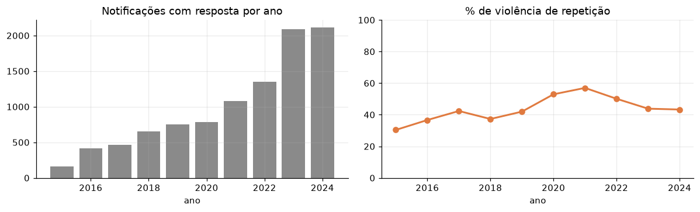

**A divisão pelo tempo.** Treino de 2015 a 2023, teste em 2024:

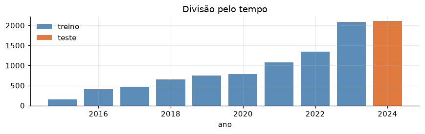

**As 36 combinações de hiperparâmetros.** AUC na validação cruzada, calculada só no treino:

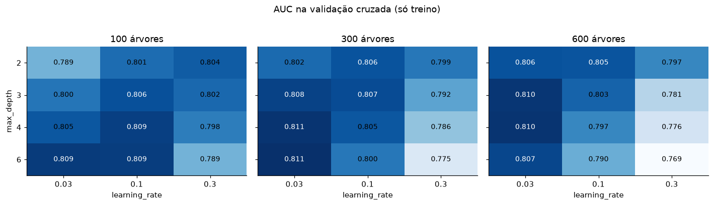

**Treino e validação em cada combinação.** Quanto mais o modelo se ajusta ao treino, mais as duas linhas se afastam:


**Treino e teste lado a lado** com o modelo escolhido:

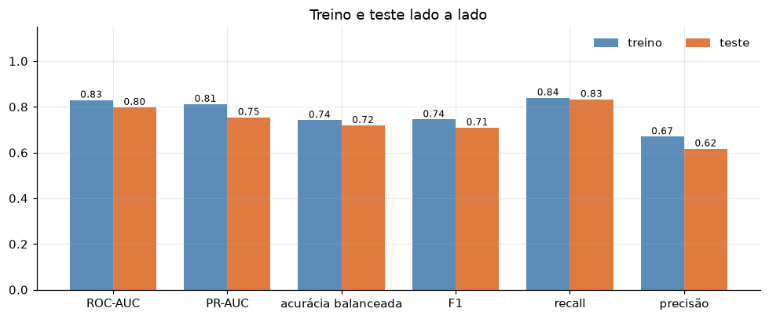

**Curva ROC e matriz de confusão** no teste de 2024:

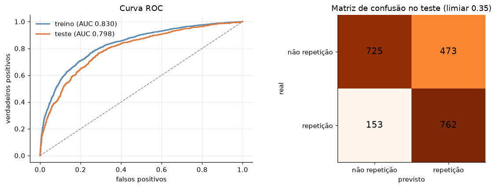

**Overfitting pela profundidade das árvores.** O treino sobe até 0,996, e a validação e o teste caem:

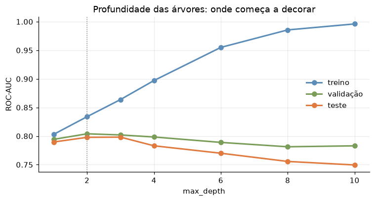

**AUC por ano.** O padrão aprendido continua valendo em 2024:

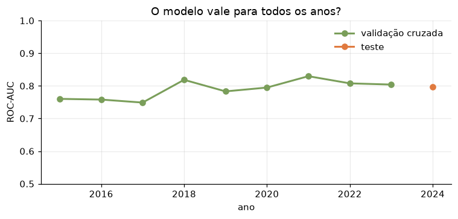

**O que mais pesa na previsão.** Laranja puxa para repetição, azul puxa para não:

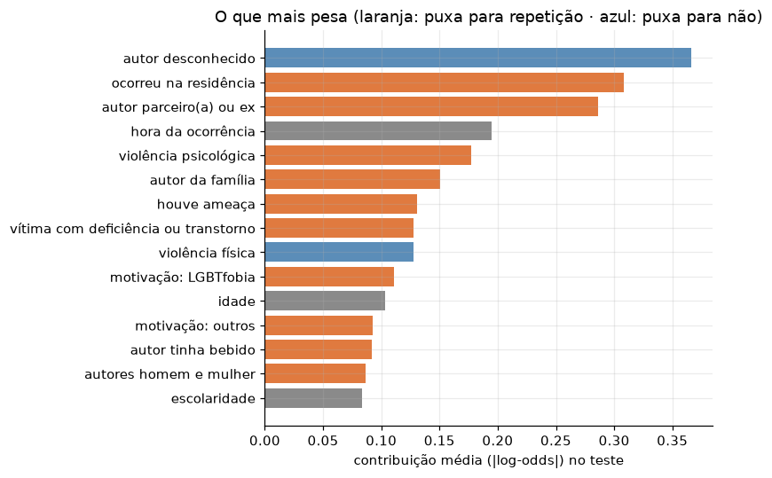

### Parte 2 · Desertos de cuidado

**As variáveis dos municípios.** Antes e depois do `log(1 + x)`:

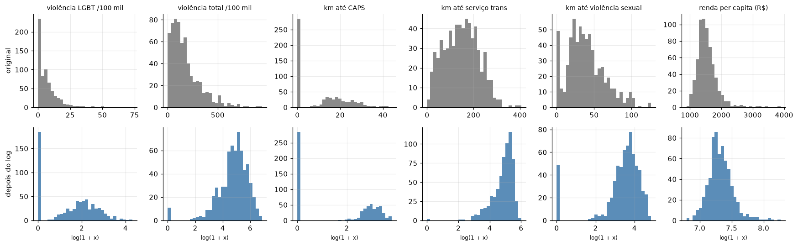

**PCA.** Quanto cada componente explica e o que carrega:

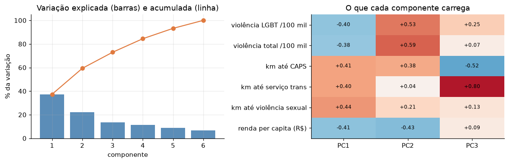

**As 36 combinações de hiperparâmetros.** Silhueta na validação cruzada, calculada só no treino:

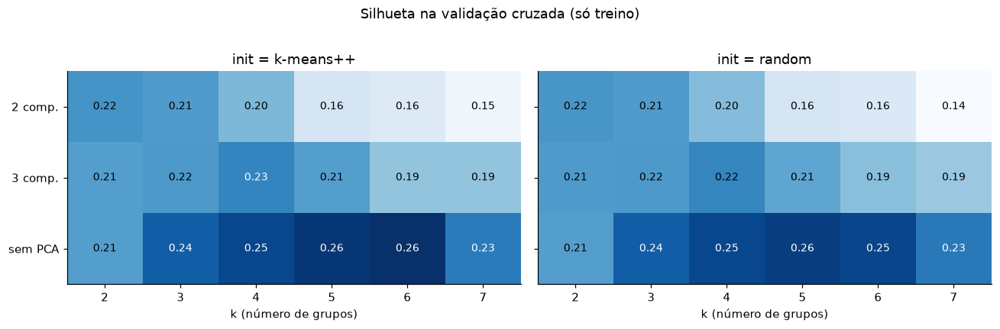

**Treino e teste lado a lado** e a curva do cotovelo:

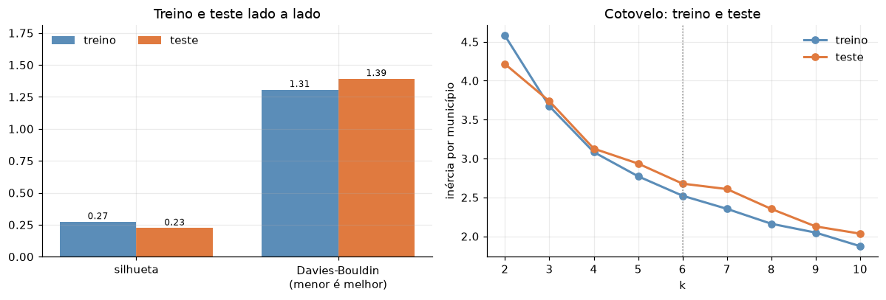

**Silhueta por número de grupos**, no treino e no teste:

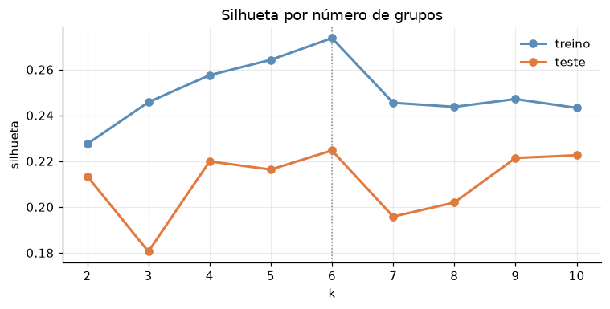

**Os grupos no plano do PCA e no mapa do estado.** O deserto de cuidado está em vermelho:

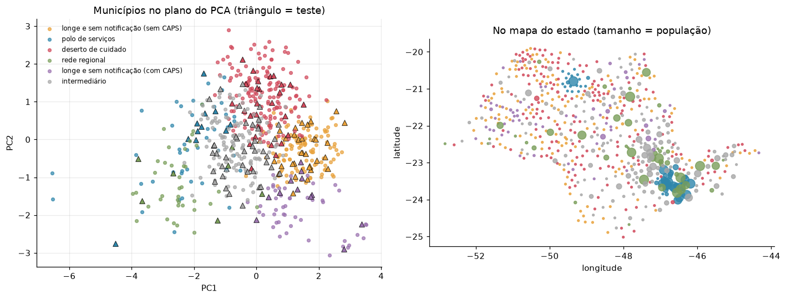

**Perfil de cada grupo** (mediana):

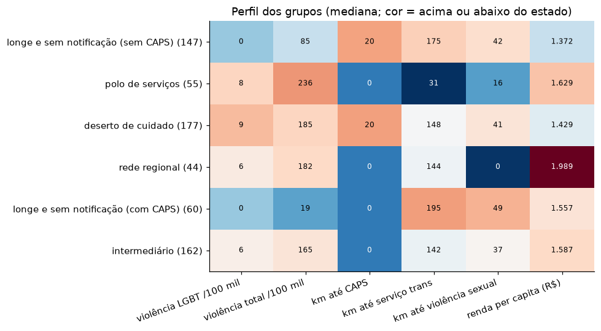

## Estrutura

```
RELATORIO_ML.md                   relatório das duas partes (problema → conclusão)
ml/
  violencia_de_repeticao.ipynb    parte 1, executado, com todas as saídas
  desertos_de_cuidado.ipynb       parte 2, executado, com todas as saídas
  preparar_dados.py               baixa o SINAN e gera o recorte da parte 1
  preparar_municipios.py          junta SINAN, CNES e IBGE por município (parte 2)
  requirements.txt
  dados/
    README.md                     fontes, links, períodos, recortes e campos
    sinan_violencia_lgbt_sao_paulo_2015_2024.csv
    municipios_sp_desertos_de_cuidado.csv
  figuras/                        gráficos gerados pelos notebooks
  modelo/                         modelo XGBoost, grades de hiperparâmetros e municípios por grupo
```

## Como rodar

Requisito: Python 3.11 ou mais novo.

```bash
python -m venv .venv
```

```bash
.venv/Scripts/pip install -r ml/requirements.txt
```

As duas tabelas já estão no repositório. Para gerar de novo a partir do DATASUS e do IBGE (cerca de 250 MB e 15 minutos):

```bash
.venv/Scripts/python ml/preparar_dados.py
```

```bash
.venv/Scripts/python ml/preparar_municipios.py
```

Para executar os notebooks de ponta a ponta:

```bash
cd ml && ../.venv/Scripts/jupyter nbconvert --to notebook --execute --inplace violencia_de_repeticao.ipynb desertos_de_cuidado.ipynb
```

No Linux e no macOS, troque `.venv/Scripts/` por `.venv/bin/`.

## Roteiro do vídeo (até 5 min)

1. **0:00 · O problema.** O Aquenda e as duas perguntas: quem precisa de retorno (a violência que se repete) e onde falta cuidado (os desertos). Por que uma é supervisionada e a outra não.
2. **0:30 · Os dados.** O SINAN no FTP do DATASUS, o CNES e o Censo 2022. Os recortes: 9.856 fichas na cidade e 645 municípios no estado. O dado que choca: só 2 municípios com serviço trans habilitado pelo SUS.
3. **1:10 · Parte 1, XGBoost.** A divisão pelo tempo (treino 2015–2023, teste 2024), o vazamento evitado e a grade de 36 combinações. Treino, validação e teste lado a lado (0,830 / 0,804 / 0,798), a curva de profundidade mostrando o overfitting e o que pesa: a repetição vem de casa.
4. **2:30 · Parte 2, KMeans + PCA.** O log e a padronização, o PCA e a grade de 36 combinações, com o PCA de 2–3 componentes perdendo informação. Silhueta 0,274 no treino e 0,225 no teste, e o cotovelo mostrando o overfitting com k grande.
5. **3:40 · Os desertos no mapa.** Os 6 grupos, com o deserto de cuidado em vermelho: 177 municípios, 1,7 milhão de pessoas, nenhum CAPS no município e serviço trans a 148 km. O grupo "longe e sem notificação" e o que o silêncio quer dizer.
6. **4:20 · Para o cidadão.** O que muda no Aquenda: acolhimento para quem sofre em casa e um mapa honesto, com teleatendimento, ONG e Defensoria onde não há nada perto. Os limites dos dados de notificação e do CNES.
