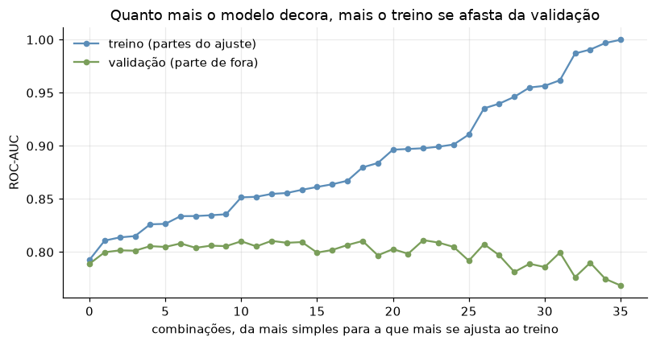

# Aquenda · Inteligência Artificial & Machine Learning

Global Solution 2026.2 · FIAP · CitizenTech

O Aquenda é um app para a comunidade LGBTQIAPN+ de São Paulo, com casas de acolhimento, salas de conversa moderadas e um mapa de serviços. Nesta entrega, o problema vira uma pergunta de Machine Learning, respondida com dados públicos reais:

> Quando uma pessoa LGBTQIAPN+ é atendida por violência na cidade de São Paulo, dá para saber, pelo que a ficha registra, se essa violência **já aconteceu outras vezes**?

| Integrante | RM |
|---|---|
| Giovanne Charelli Zaniboni Silva | 556223 |
| Gustavo Oliveira de Moura | 555827 |
| Lynn Bueno Rosa | 551102 |

## Resumo

- **Dados:** 9.856 notificações de violência interpessoal do SINAN (DATASUS), cidade de São Paulo, 2015 a 2024, com pessoa homossexual, bissexual, travesti ou trans. Em 45,6% delas, a violência já tinha acontecido antes.
- **Modelo:** XGBoost, comparado com uma regressão logística e com um modelo que chuta a classe mais comum.
- **Treino:** 36 combinações de `max_depth`, `learning_rate` e `n_estimators`, com validação cruzada de 5 partes só no treino (2015–2023). O teste é 2024, usado uma vez no fim.
- **Resultado:** ROC-AUC 0,830 no treino, 0,804 na validação cruzada e **0,798 no teste**. O modelo encontra 83% dos casos de repetição de 2024.
- **Para o cidadão:** com autor da família, 72% dos casos já tinham acontecido antes. Com parceiro(a) ou ex, 66%. Com desconhecido na rua, 20%. A violência que se repete está em casa.

O relatório completo está em [`RELATORIO_ML.md`](RELATORIO_ML.md).

## Gráficos

Todos são gerados pelo notebook e ficam em `ml/figuras/`.

**Os dados.** Fichas com resposta e % de violência de repetição por ano:


**A divisão pelo tempo.** Treino de 2015 a 2023, teste em 2024:


**As 36 combinações de hiperparâmetros.** AUC na validação cruzada, calculada só no treino:


**Treino e validação em cada combinação.** Quanto mais o modelo se ajusta ao treino, mais as duas linhas se afastam:



**Treino e teste lado a lado** com o modelo escolhido:


**Curva ROC e matriz de confusão** no teste de 2024:


**Overfitting pela profundidade das árvores.** O treino sobe até 0,996, e a validação e o teste caem:


**AUC por ano.** O padrão aprendido continua valendo em 2024:


**O que mais pesa na previsão.** Laranja puxa para repetição, azul puxa para não:


## Estrutura

```
RELATORIO_ML.md                   relatório (problema → conclusão)
ml/
  violencia_de_repeticao.ipynb    notebook executado, com todas as saídas
  preparar_dados.py               baixa os dados do DATASUS e gera o recorte
  requirements.txt
  dados/
    README.md                     fonte, link, período, recorte e campos
    sinan_violencia_lgbt_sao_paulo_2015_2024.csv
  figuras/                        gráficos gerados pelo notebook
  modelo/                         modelo treinado, metadados e grade de hiperparâmetros
```

## Como rodar

Requisito: Python 3.11 ou mais novo.

```bash
python -m venv .venv
```

```bash
.venv/Scripts/pip install -r ml/requirements.txt
```

O CSV do recorte já está no repositório. Para baixar e filtrar de novo a partir do DATASUS (cerca de 240 MB e 10 minutos):

```bash
.venv/Scripts/python ml/preparar_dados.py
```

Para executar o notebook de ponta a ponta:

```bash
cd ml && ../.venv/Scripts/jupyter nbconvert --to notebook --execute --inplace violencia_de_repeticao.ipynb
```

No Linux e no macOS, troque `.venv/Scripts/` por `.venv/bin/`.

## Roteiro do vídeo (até 5 min)

1. **0:00 · O problema.** O Aquenda e por que a violência que se repete importa: ela vem de perto e é a que mais precisa de acolhimento. A pergunta de ML em uma frase.
2. **0:40 · Os dados.** O SINAN no FTP do DATASUS, o recorte (cidade de São Paulo, pessoas LGBTQIAPN+, 2015–2024) e o funil de 16.178 para 9.856 fichas. O gráfico de fichas e de % de repetição por ano.
3. **1:30 · Preparação.** As 124 variáveis da ficha, o "ignorado" como informação e o que ficou de fora por vazamento (encaminhamentos). A divisão pelo tempo: treino 2015–2023, teste 2024.
4. **2:10 · Modelo e hiperparâmetros.** Por que XGBoost. O mapa de calor das 36 combinações, com passo alto e muitas árvores piorando. A regra de pegar a combinação mais simples a um desvio da melhor.
5. **3:00 · Resultados.** A tabela de treino, validação e teste lado a lado (0,830 / 0,804 / 0,798). A matriz de confusão de 2024. A curva de profundidade mostrando o overfitting a partir de `max_depth` 4. A AUC estável por ano.
6. **4:00 · Para o cidadão.** O gráfico do que pesa e a tabela de % de repetição por tipo de autor. O que isso muda no Aquenda e por que o modelo serve para planejar a rede, não para decidir o atendimento de uma pessoa. Os limites do dado de notificação.
