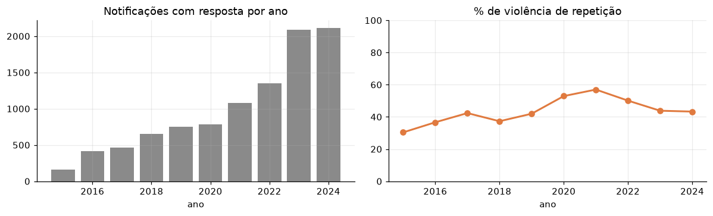
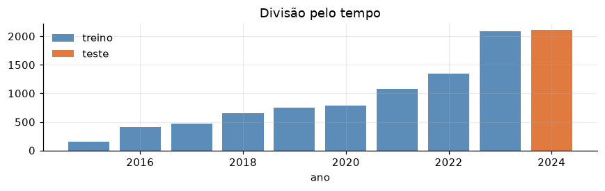
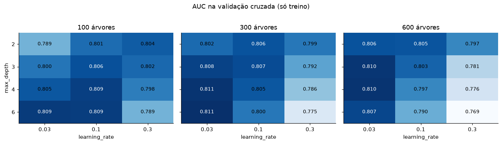
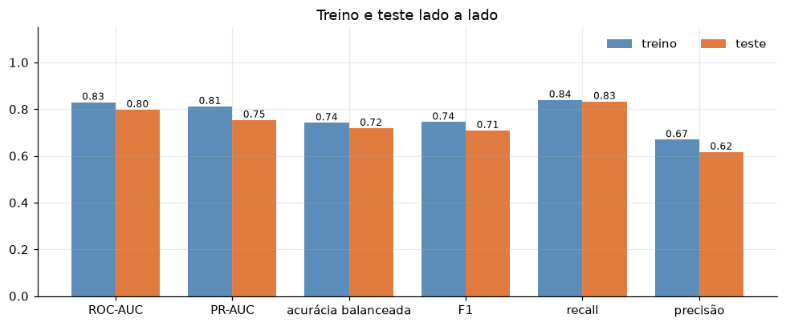
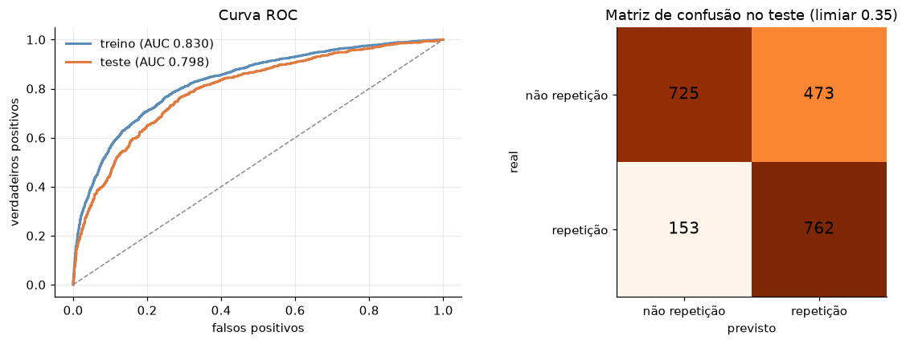
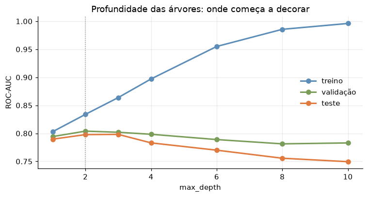
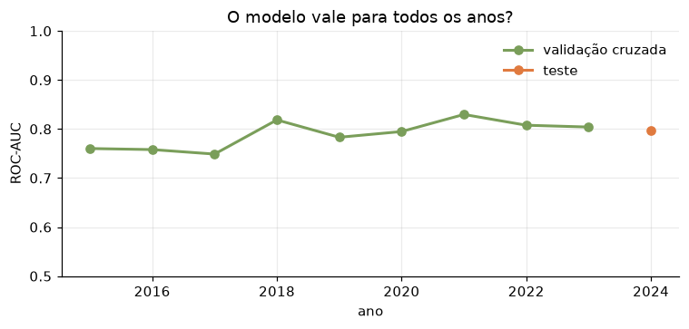
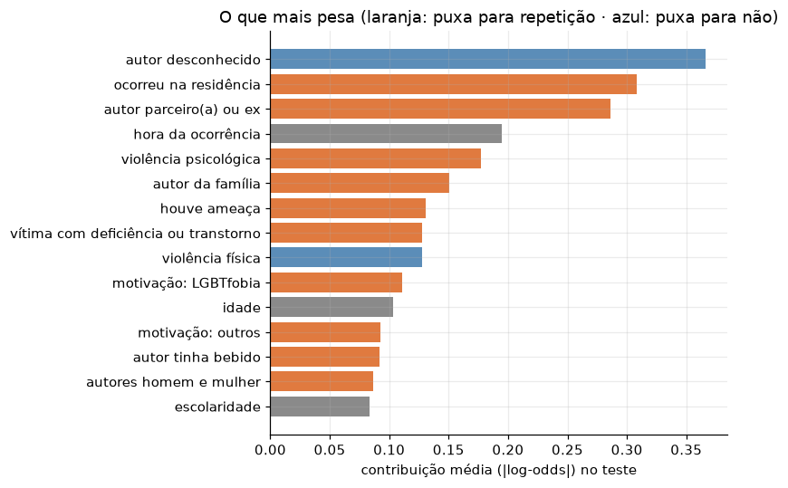

# Relatório de Machine Learning · Aquenda

**Violência de repetição contra pessoas LGBTQIAPN+ na cidade de São Paulo**

Global Solution 2026.2 · CitizenTech · Inteligência Artificial & Machine Learning

Giovanne Charelli Zaniboni Silva (RM 556223) · Gustavo Oliveira de Moura (RM 555827) · Lynn Bueno Rosa (RM 551102)

Notebook executado: [`ml/violencia_de_repeticao.ipynb`](ml/violencia_de_repeticao.ipynb) · Dados: [`ml/dados/README.md`](ml/dados/README.md)

---

## 1. Problema e dados reais

O Aquenda é um app para a comunidade LGBTQIAPN+ de São Paulo. Ele tem casas de acolhimento com vagas em tempo real, salas de conversa moderadas e um mapa de serviços (CRAS, CAPS, ambulatório trans, Defensoria). A violência mais difícil de sair é a que se repete: quase sempre vem de alguém que mora junto ou é próximo. É para essa pessoa que acolhimento e rede de apoio fazem mais diferença.

**Pergunta de ML.** Quando uma pessoa LGBTQIAPN+ é atendida por violência na cidade de São Paulo, dá para saber, só com o que a ficha de notificação registra, se essa violência **já aconteceu outras vezes**? É uma classificação binária.

**Dados.** Usamos as notificações de violência interpessoal do **SINAN** (Ministério da Saúde, DATASUS), de 2015 a 2024. São os arquivos `VIOLBRaa.dbc` do FTP público do DATASUS, todos reais e sem nada simulado. O recorte:

- fichas notificadas na cidade de São Paulo;
- com pessoa homossexual ou bissexual, ou travesti, mulher trans ou homem trans: são 16.178 fichas;
- tirando a lesão autoprovocada (outra pergunta, outra rede de cuidado), sobram 10.934;
- tirando as fichas sem resposta no campo "ocorreu outras vezes?", ficam **9.856 notificações**.

Dessas, **45,6% são violência de repetição**. As classes estão quase equilibradas.

O número de fichas cresce muito no período, de 158 com resposta em 2015 para mais de 2 mil por ano a partir de 2023. Isso é mais preenchimento dos campos de orientação e identidade e mais notificação, e não só mais violência. A taxa de repetição também muda: 30% em 2015, 57% em 2021 e 43% em 2024.

## 2. Escolha do modelo

Escolhemos o **XGBoost**, gradient boosting de árvores, pelos seguintes motivos:

- **Dados tabulares, quase todos binários.** A ficha é uma lista de sim/não: tipo de violência, meio, quem é o autor. Nesse formato, as árvores com boosting costumam ser o modelo mais forte.
- **Interações.** "Violência psicológica" pesa diferente quando vem de um parceiro dentro de casa e quando vem de um desconhecido na rua. As árvores aprendem essas combinações sem precisarmos escrevê-las.
- **Valores faltantes.** A hora falta em 40% das fichas e a escolaridade em 15%. O XGBoost aprende para que lado mandar o faltante, sem inventar valor.
- **Leitura.** A contribuição de cada variável em cada previsão (`pred_contribs`) mostra o que pesou.

Os outros modelos da lista não se encaixam:

- **LSTM:** não há sequência no tempo da mesma pessoa.
- **MLP:** pede mais dados e explica menos.
- **KMeans + PCA:** não responde a uma pergunta supervisionada.

Para saber se o XGBoost vale a pena, comparamos com duas referências:

- um modelo que chuta sempre a classe mais comum: AUC 0,50;
- uma regressão logística: AUC 0,79 na validação cruzada.

## 3. Preparação e divisão treino/teste

**Variáveis.** Todas vêm do que a ficha registra no atendimento:

- quem é a pessoa: idade, escolaridade, raça/cor, deficiência, orientação, identidade;
- onde e quando: local, hora, se foi à noite;
- que violência foi: tipos e meios;
- quem é o provável autor: vínculo, sexo, uso de álcool, quantos;
- a motivação.

Os campos sim/não (1 sim, 2 não, 9 ignorado) viram duas colunas cada, "sim" e "ignorado". Assim, o modelo sabe quando o campo ficou em branco. Criamos dois resumos: "autor da família" e "autor parceiro(a) ou ex". São **124 variáveis** no total.

**Vazamento.** Os encaminhamentos (delegacia, conselho tutelar, rede de saúde, Defensoria) e a evolução do caso ficaram de fora. Eles são decididos depois do atendimento, muitas vezes justamente porque a violência se repete. Com eles, o modelo pareceria ótimo sem servir para nada.

**Divisão pelo tempo.**

| | Notificações | % repetição |
|---|---|---|
| Treino: 2015 a 2023 | 7.743 | 46,2% |
| Teste: 2024 | 2.113 | 43,3% |

O modelo seria usado em fichas novas, então o teste é o ano mais recente. Uma divisão aleatória misturaria os anos e daria uma nota otimista. O teste só foi usado uma vez, no fim. Toda a escolha de hiperparâmetros e do limiar foi feita com validação cruzada estratificada de 5 partes **só no treino**.

## 4. Treino com diferentes hiperparâmetros

Testamos **36 combinações** de três hiperparâmetros, cada uma com validação cruzada de 5 partes no treino:

| Hiperparâmetro | O que controla | Valores |
|---|---|---|
| `max_depth` | complexidade de cada árvore | 2, 3, 4, 6 |
| `learning_rate` | tamanho do passo de cada árvore nova | 0,03 · 0,1 · 0,3 |
| `n_estimators` | número de árvores | 100, 300, 600 |

O resto ficou fixo: `subsample` 0,8, `colsample_bytree` 0,8 e `min_child_weight` 5.

O que a grade mostra:

- **O pior é passo alto com muitas árvores.** Com `learning_rate` 0,3, a AUC de validação cai à medida que entram mais árvores e mais profundidade: de 0,804 para 0,769 com 600 árvores e profundidade 6. É o modelo corrigindo ruído do treino.
- **O melhor é passo baixo.** `learning_rate` 0,03, com profundidade 4 a 6 e 300 árvores, chega a **0,811**.
- **A distância de 0,804 a 0,811 é pequena.** É do tamanho do desvio-padrão entre as partes da validação (0,007).

**Regra de escolha:** a combinação mais simples cuja AUC fica a menos de um desvio-padrão da melhor. Pela regra, ficou **`max_depth` 2, `learning_rate` 0,3 e 100 árvores**, com AUC de validação 0,804. A melhor da grade (profundidade 6, 300 árvores) tinha AUC de treino 0,898 contra 0,811 na validação, uma distância de 0,087. A escolhida tem distância de 0,026: rende quase igual e decora muito menos. Na validação cruzada, ela ganha da regressão logística (0,804 contra 0,790).

O limiar de decisão também saiu do treino. É o que maximiza o F1 nas previsões da validação cruzada: **0,35**. Um limiar abaixo de 0,5 favorece achar os casos de repetição (recall), que é o erro mais caro aqui.

## 5. Resultados em treino e teste

| | ROC-AUC | PR-AUC | Acurácia balanceada | Precisão | Recall | F1 |
|---|---|---|---|---|---|---|
| XGBoost · treino | 0,830 | 0,812 | 0,742 | 0,670 | 0,840 | 0,745 |
| XGBoost · validação cruzada | 0,804 | 0,780 | 0,727 | 0,658 | 0,821 | 0,730 |
| **XGBoost · teste (2024)** | **0,798** | **0,754** | **0,719** | **0,617** | **0,833** | **0,709** |
| Regressão logística · teste | 0,789 | 0,745 | 0,703 | 0,600 | 0,824 | 0,695 |

Em 2024, o modelo encontrou **762 dos 915 casos de repetição (83%)**. Em troca, deu alarme em 473 das 1.198 fichas que não eram repetição. Precisão de 62% quer dizer que, de cada 5 fichas marcadas, 3 são de fato repetição.

**Overfitting.** A queda do treino (0,830) para o teste (0,798) é de 0,03, e a validação cruzada (0,804) já tinha previsto quase isso. A curva por profundidade mostra onde começaria o problema:

| `max_depth` | 1 | 2 | 3 | 4 | 6 | 8 | 10 |
|---|---|---|---|---|---|---|---|
| treino | 0,803 | 0,834 | 0,864 | 0,897 | 0,955 | 0,986 | 0,996 |
| validação | 0,794 | 0,804 | 0,802 | 0,798 | 0,789 | 0,781 | 0,783 |
| teste | 0,790 | 0,798 | 0,798 | 0,783 | 0,770 | 0,756 | 0,750 |

Com profundidade 10, o treino chega a 0,996: o modelo praticamente decora as fichas. Mas o teste cai para 0,750. A profundidade 2 está no ponto em que validação e teste são máximos.

**Mudança no tempo.** A AUC por ano (validação cruzada nos anos de treino, modelo final em 2024) fica entre 0,75 e 0,83, sem tendência de queda. Os anos mais fracos são 2015 a 2017, com poucas fichas. O padrão aprendido continua valendo em 2024.

**O que pesa na previsão:**

| Situação na ficha | % de repetição |
|---|---|
| autor da família | 72% (1.667 fichas) |
| autor parceiro(a) ou ex | 66% (2.390) |
| ocorreu na residência | 63% (4.577) |
| violência psicológica | 61% (2.720) |
| motivação LGBTfobia | 50% (1.508) |
| ocorreu na via pública | 27% (2.517) |
| autor desconhecido | 20% (2.870) |

## 6. Conclusão para o cidadão

**A violência que se repete contra pessoas LGBTQIAPN+ em São Paulo vem de dentro de casa.** Quando o autor é da família, 7 em cada 10 casos já tinham acontecido antes. Com parceiro(a) ou ex, 2 em cada 3. Com um desconhecido na rua, 1 em cada 5. Para quem é LGBTQIAPN+, o lugar mais perigoso pode ser onde mora, e com quem mora. Isso reforça três decisões do Aquenda:

- as casas de acolhimento com vaga em tempo real;
- a sala "família" nas conversas;
- o mapa que leva até CRAS, CREAS e Defensoria.

O modelo acerta bem mais do que o acaso (AUC 0,80) e manteve o desempenho em 2024, um ano que nunca tinha visto. Mesmo assim, **ele não serve para decidir o atendimento de uma pessoa**. Ele erra 17% dos casos de repetição e dá alarme falso em 4 de cada 10 fichas sem repetição. Serve para planejar:

- a rede de saúde e de assistência pode priorizar retorno e acompanhamento nas fichas com perfil de repetição;
- o app pode mostrar primeiro acolhimento e apoio para quem conta estar nessa situação.

**Limites.**

- É dado de notificação: só aparece quem chegou a um serviço de saúde e teve a ficha preenchida.
- Muita violência contra pessoas LGBTQIAPN+ nunca é notificada.
- Orientação e identidade ficam como "ignorado" em parte das fichas, então o recorte é menor do que a realidade.
- O campo "ocorreu outras vezes?" depende do que a pessoa conta no atendimento.
